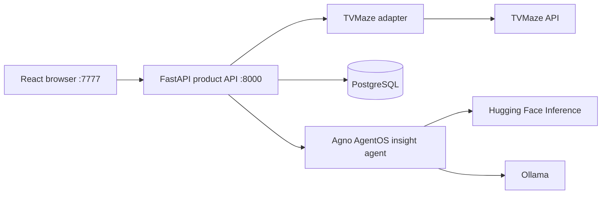
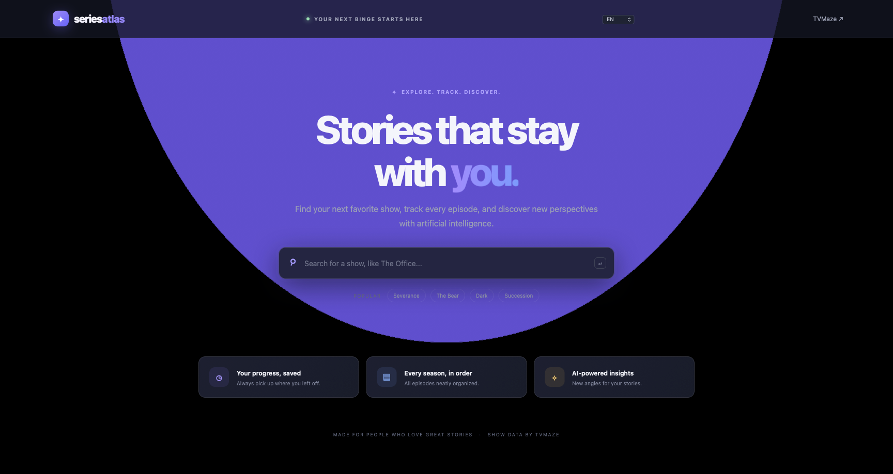
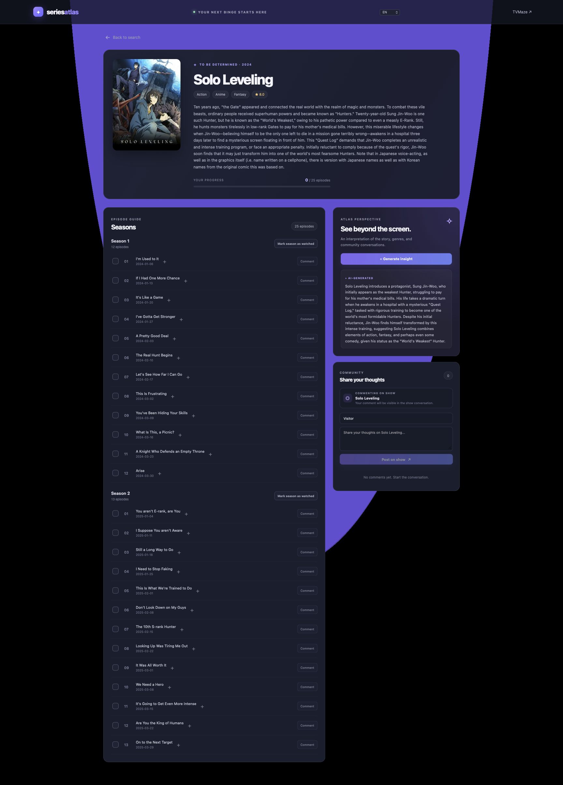

# Series Atlas | Beecrowd Technical Challenge

Technical challenge solution for **Beecrowd**. The assignment describes an early-stage streaming platform, and Series Atlas is the application name used for this implementation.

Series Atlas is a web application for discovering and tracking TV shows. Users can search the TVMaze catalog, browse episodes by season, mark episodes as watched, comment on shows and episodes, and generate contextual AI-powered insights. Built with React, FastAPI, PostgreSQL, SQLAlchemy, Agno AgentOS, and Vite.

## Architecture

- **Frontend:** React and Vite provide an asynchronous, responsive single-page interface.
- **Product API:** FastAPI exposes typed endpoints on port **8000**.
- **Frontend:** React and Vite run independently on port **7777** and call the API on port **8000**.
- **Agent runtime:** Agno AgentOS shares the FastAPI application and hosts one bounded insight agent.
- **Persistence:** SQLAlchemy and Alembic store comments and watched state in PostgreSQL. TVMaze remains the source of series and episode metadata.
- **AI provider:** Ollama and Hugging Face Inference are isolated behind `InsightProvider`. The model and credentials stay on the server. Missing credentials, provider failures, and empty responses produce a clearly labelled contextual fallback.



The system runs in three Compose services: a Vite frontend, a FastAPI API, and PostgreSQL. The frontend listens on **7777** and the API on **8000**. The product API is available under `/api`; AgentOS is mounted under `/os` and protected by `OS_SECURITY_KEY`.

## Features

- Debounced series search with title, year, genres, and poster.
- Series details, summary, genres, and episodes grouped by season.
- Watched state and comments persisted in PostgreSQL and scoped to a random browser identity stored in an HttpOnly cookie.
- Comments on a series or a specific episode.
- English and Brazilian Portuguese interface with a persisted language selector.
- AI insight based on the series or episode synopsis, genres, and matching comments.
- A transparent fallback when Hugging Face is not configured or cannot answer.
- OpenAPI documentation at `/docs` and a health endpoint at `/health`.

## Visual preview

The interface uses a dark, focused layout for searching, browsing, tracking episodes, discussing series, and viewing AI insights.

### Home and series search



### Series details, episodes, community, and AI insight



## Run with Docker Compose

Requirements: Docker Engine and Docker Compose v2.

```bash
cp .env.example .env
make run
```

Open <http://localhost:7777>. Compose starts the React development server, PostgreSQL, the API, and the AgentOS runtime. The API health check is available at <http://localhost:8000/health>. Stop with `Ctrl+C`. PostgreSQL data persists in the `postgres_data` volume.

If Docker is reusing an old container or dependency state, force a clean recreation with:

```bash
make docker-run-force
```

The UI and fallback insight work without an AI token. The application supports a local Ollama model and Hugging Face Inference Providers. Select the provider with `AI_PROVIDER`.

For a free local setup, install [Ollama](https://ollama.com), start it, and download the model:

See [OLLAMA-LOCAL.md](ai-models/OLLAMA-LOCAL.md) for the complete local and cloud Ollama setup guidance.

```bash
# Linux or macOS host
curl -fsSL https://ollama.com/install.sh | sh
ollama serve
ollama pull qwen2.5:3b
```

In `backend/.env`, use:

```env
AI_PROVIDER=ollama
OLLAMA_MODEL=qwen2.5:3b
OLLAMA_BASE_URL=http://localhost:11434
```

The application calls Ollama locally and does not require an API token or paid inference credits. If Ollama is unavailable, the insight endpoint returns the built-in fallback.

Ollama is installed on the host machine, not in this project's `Dockerfile`. The application container connects to the host Ollama service through `host.docker.internal:11434`. Installing Ollama and downloading a model inside the application image would make builds much larger and would lose the model whenever the image is rebuilt. For a hosted production environment, run Ollama as a separate service or use a managed inference provider and set `OLLAMA_BASE_URL` accordingly.

If the API reports that the `ollama` Python package is not installed, update the backend environment before starting it:

```bash
cd backend
uv sync --group dev
source .env
uv run uvicorn series_app.main:app --reload --port 8000
```

When running with Docker, rebuild the application image after dependency changes:

```bash
docker compose build --no-cache api frontend
docker compose up
```

To use Hugging Face instead, edit the environment file and set:

```env
AI_PROVIDER=huggingface
HF_TOKEN=your_token
```

`HF_MODEL` selects the server-side model. The default is [Qwen3-4B-Instruct-2507](https://huggingface.co/Qwen/Qwen3-4B-Instruct-2507). The root `.env.example` uses Hugging Face for the Docker demonstration; the local `backend/.env.example` uses Ollama.

### Why this model?

The Qwen model is public and uses the Apache-2.0 license, so the evaluator does not need approval to access a gated model repository. Its 4B instruction model size is a proportionate choice for this challenge: the AI feature produces a short insight from a limited context (series or episode synopsis, genres, and comments). That keeps the model choice aligned with a simple, bounded task.

Public model access does not remove the need to configure inference. To generate insights, the evaluator still needs their own Hugging Face token with **Make calls to Inference Providers** permission and available provider credits. If no token is configured, the application returns its built-in fallback. Provider availability and account limits can change.

The token never goes to the browser. Set a unique `OS_SECURITY_KEY` before exposing AgentOS endpoints beyond a local demo. The sample Compose value is for local use only.

### Generate and configure `OS_SECURITY_KEY`

`OS_SECURITY_KEY` is a secret that you create for this application. It is not issued by Beecrowd or Hugging Face. AgentOS uses it to protect its API. When a protected AgentOS endpoint is called, the client sends it as a bearer token in the `Authorization` header.

Generate a random key in a terminal:

```bash
openssl rand -hex 32
```

Copy the generated value into `OS_SECURITY_KEY` in the root `.env` file:

```env
OS_SECURITY_KEY=paste_the_generated_value_here
```

If `.env` does not exist yet, create it from `.env.example` first. Replace the example value with the generated key before starting the application. Keep `.env` private and never commit it. The repository's `.gitignore` excludes it.

This key is separate from `HF_TOKEN`: `OS_SECURITY_KEY` protects AgentOS endpoints, while `HF_TOKEN` lets the server call Hugging Face to generate AI insights. The regular product routes used by the React interface do not need this bearer key.


## Local development

Requirements: Python 3.12, `uv`, Node.js 22, Yarn, and a PostgreSQL instance.

Local development uses a different database configuration from Docker Compose. Docker resolves the database through the hostname `db`; a process running directly on the host must use `localhost`. The repository provides separate templates for these environments:

```bash
cp backend/.env.example backend/.env
```

Edit `backend/.env` when necessary. In particular, set `HF_TOKEN` to enable model-generated insights and adjust `DATABASE_URL` to match the local PostgreSQL role. The provided local template uses `postgres` without a password and connects to `localhost`.

Install the backend dependencies, apply the migrations, and start the API:

```bash
cd backend
uv sync --group dev
set -a
source .env
set +a
uv run alembic upgrade head
PYTHONPATH=src uv run uvicorn series_app.main:app --reload --port 8000
```

In another terminal, start the frontend:

```bash
cd frontend
cp .env.example .env
yarn install
yarn dev
```

The frontend runs at `http://localhost:7777` and uses `VITE_API_URL=http://localhost:8000` by default. When the frontend is hosted elsewhere, set `VITE_API_URL` to the public API URL during the frontend build. The API allows the configured `FRONTEND_URL` origin and accepts credentials for the anonymous visitor cookie.

## API

| Method | Path | Purpose |
|---|---|---|
| `GET` | `/api/search?q=...` | Search the TVMaze catalog |
| `GET` | `/api/shows/{show_id}` | Read series details, episodes, and watched IDs |
| `PUT` | `/api/shows/{show_id}/episodes/{episode_id}/watched` | Update watched state |
| `GET` | `/api/shows/{show_id}/comments?episode_id=...` | List series or episode comments |
| `POST` | `/api/shows/{show_id}/comments` | Create a comment |
| `POST` | `/api/shows/{show_id}/insights` | Generate an AI insight or fallback |
| `GET` | `/health` | Check application health |

## Tests and quality checks

```bash
cd backend
uv run ruff check src tests
uv run pytest --cov=series_app --cov-report=term-missing
```

The GitHub Actions workflow runs backend linting and tests and builds the frontend on pushes and pull requests.

## Project layout

```text
beecrowd/
├── backend/                 # FastAPI app, domain services, migrations, and tests
├── frontend/                # React and Vite application
├── docs/                    # Presentation outline and visual previews
├── .github/workflows/       # CI checks
├── docker-compose.yml       # App and PostgreSQL services
├── Dockerfile               # Single application image, including the React bundle
└── README.md                # Project and setup guide
```

## Deliberate scope and trade-offs

- TVMaze owns catalog metadata. The application persists only state and comments it owns.
- The random browser cookie keeps the challenge small. It is not account authentication and does not provide cross-device identity.
- Model selection is server configuration because the challenge has one model and no operator screen. Provider credentials are never stored in PostgreSQL or accepted from the browser.
- The insight agent has one bounded task. A multi-agent workflow, Redis, Celery, and a separate frontend container would add infrastructure without helping this scope.
- A production product should add authenticated accounts, ownership and authorization rules, comment moderation, rate limits, managed secrets, monitoring, and measured caching decisions. The frontend and API are already separate runtime services, so they can be deployed independently.

## Presentation

The 30-minute interview outline is in [`docs/presentation-outline.md`](docs/presentation-outline.md). It covers architecture and trade-offs, a live walkthrough, code review, and likely reviewer questions.
